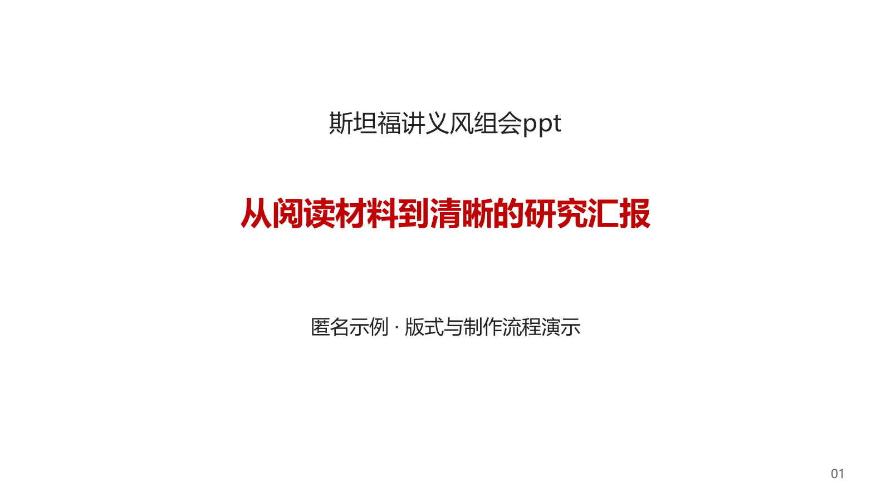
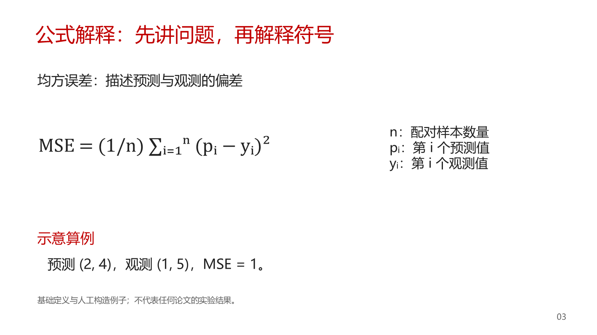
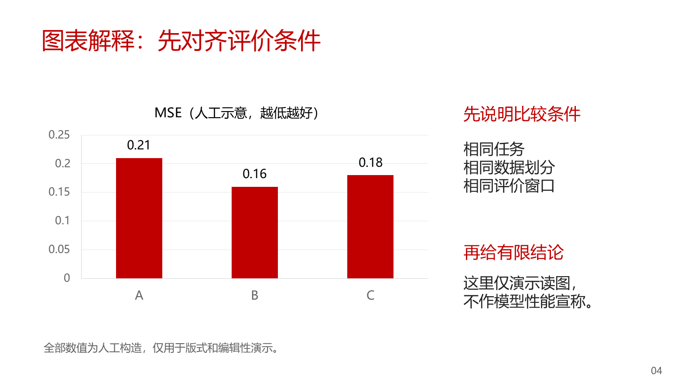
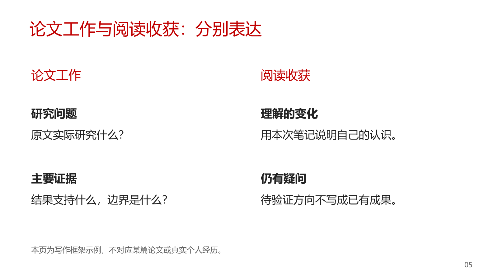
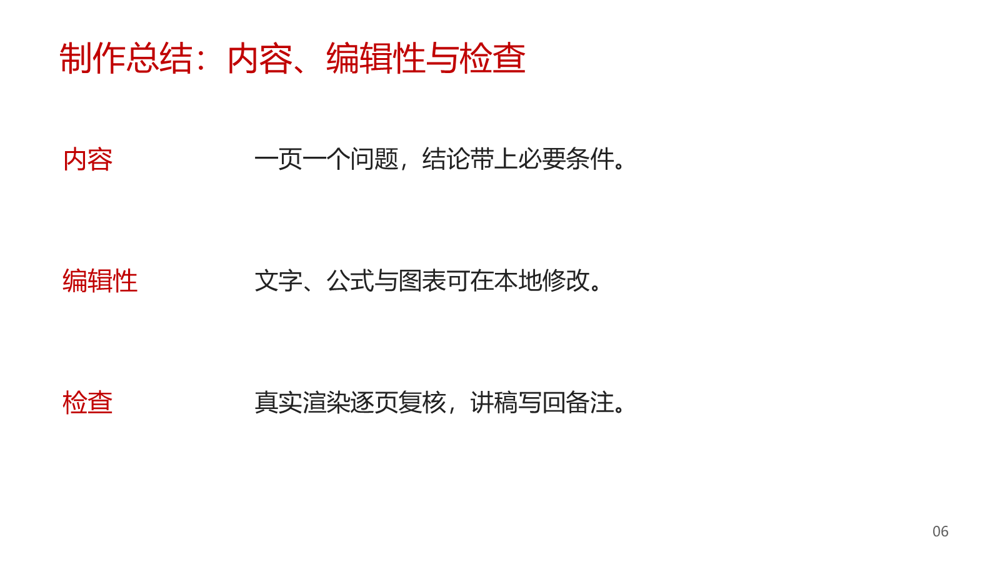
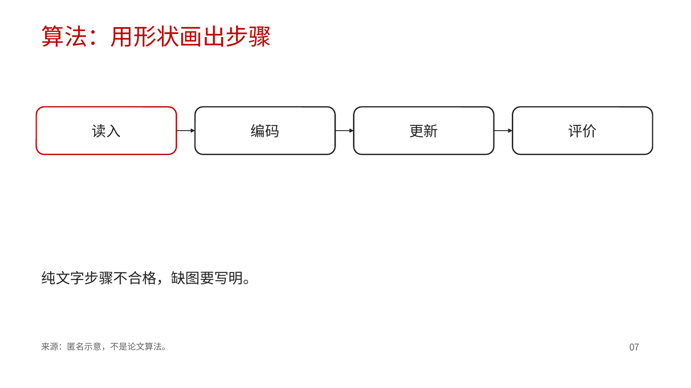
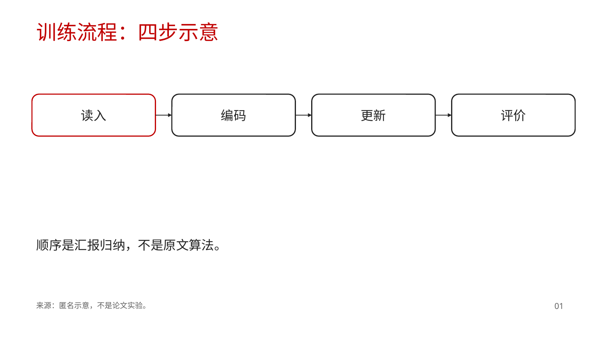
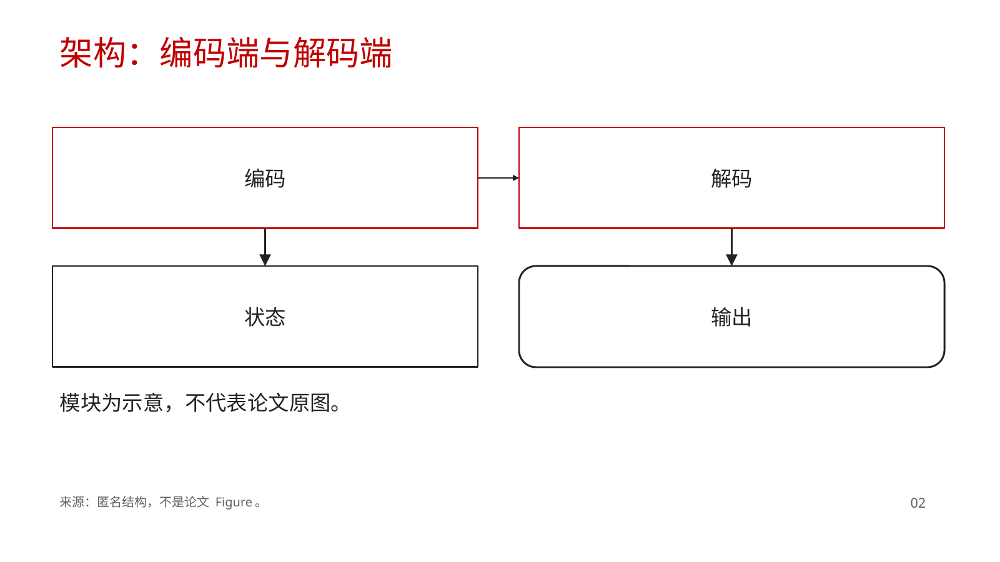
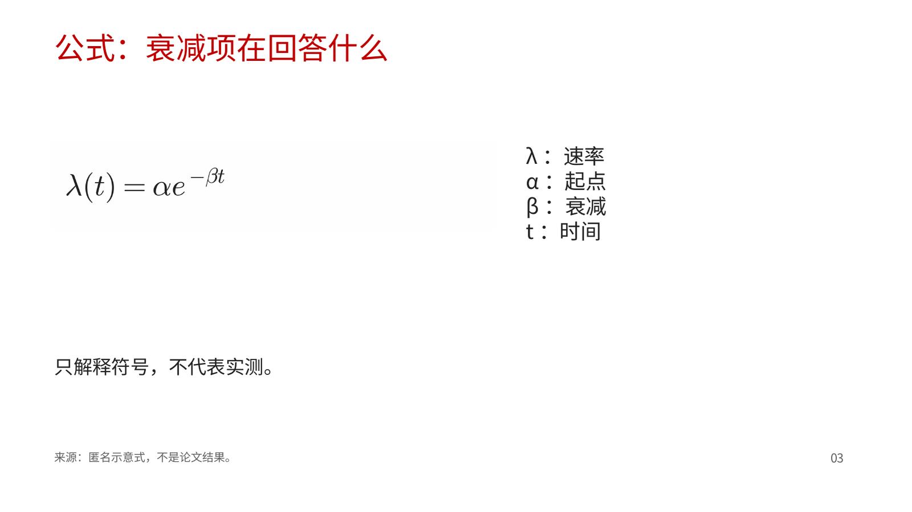

# 斯坦福课件风格PPT制作

一个面向中文组会、论文阅读与科研学习汇报的 Codex skill。采用斯坦福CS课程讲义式视觉：**白底、黑灰正文、红色强调、充分留白、原图与解释就近放置**，默认交付本地可编辑 PPTX。

它不只是配色模板，也是一套从材料到可汇报成品的制作流程。流程借鉴 [codex-ppt](https://github.com/ningzimu/codex-ppt-skill)，但不默认把整页图片当作最终PPT。

> 独立项目，不是 Stanford 官方模板，与 Stanford University 无隶属或背书关系。公开仓库不含私人组会原稿、私人截图、账户凭据或本机文件路径。

## Demo

[下载可编辑示例 PPTX](assets/demo.pptx)

匿名示例展示封面、讲义式层次、公式解释、原生图表、论文工作／阅读收获双栏、总结，以及一页图优先的四步流程。前 6 页的内容保持原样，第 7 页只增加示意图。所有示例数值均为教学示意，不是论文实验结果；不含真实姓名、学校、日期或私人研究材料。`assets/diagram-samples/figure-first.pptx` 另有三页匿名样张：四步流程、双栏架构、公式图加符号说明。`assets/layout-samples/basics.pptx` 是封面、原生表格、文字双栏、折线、散点、图注、定义框和可选单击出现的匿名样张，其中的整数同样不是实验结果。









示意图样张：





## 安装

将整个仓库放入个人skills目录，并命名为 `stanford-lecture-ppt`。例如PowerShell：

```powershell
git clone https://github.com/121209/stanford-lecture-ppt-skill.git "$env:USERPROFILE\.codex\skills\stanford-lecture-ppt"
```

macOS / Linux：

```bash
git clone https://github.com/121209/stanford-lecture-ppt-skill.git ~/.codex/skills/stanford-lecture-ppt
```

如果已有同名目录，请不要覆盖已有修改。安装后在Codex中调用：

```text
使用 $stanford-lecture-ppt，依据这些论文和阅读笔记，制作10页、约15分钟的组会汇报。
重点是近期读了什么、论文主线和我的阅读收获。输出可编辑PPTX，讲稿写入每页备注。
```

局部修订：

```text
使用 $stanford-lecture-ppt，直接修改这份PPTX，保留页数、顺序和用户改动。
只修正第3页公式和第5页讲解，不改成整页图片。
```

仅要求“整理语料”“只出大纲”时，本skill不会擅自开始PPT生产。

## 更新已安装的 skill

**GitHub 上合并或推送更新，不会自动更新其他人电脑中已安装的副本。** 按上面的 `git clone` 安装后，使用者需要主动拉取。PowerShell：

```powershell
git -C "$env:USERPROFILE\.codex\skills\stanford-lecture-ppt" status --short
git -C "$env:USERPROFILE\.codex\skills\stanford-lecture-ppt" pull --ff-only
```

macOS / Linux：

```bash
git -C ~/.codex/skills/stanford-lecture-ppt status --short
git -C ~/.codex/skills/stanford-lecture-ppt pull --ff-only
```

目录不同就使用实际安装路径。若有本地修改或分支已经分叉，先备份并处理差异，不用强制重置或覆盖。ZIP 下载、复制文件或安装器下载得到的目录若没有 `.git`，不能用 `git pull` 更新；需要备份自己的修改和私有素材，再重新下载安装新版。

Codex 会检测**本地技能文件**的变化；更新未显示时重启 Codex。这是本地检测，不是从 GitHub 自动拉取。参见 [OpenAI 官方技能文档](https://learn.chatgpt.com/docs/build-skills)。

## 纯风格迁移与局部修改

“内容不变，只换风格”保留正文、公式含义、图表数据、页序和备注，只调整视觉属性。单页补充不附封面；公式美化保留语义、可编辑性与兼容显示；整图点击进入使用同一次单击触发的对象动画。详见 [局部编辑与动画](references/scoped-edits.md)。

## 流程

材料阅读和事实核对 → 逐页大纲与素材映射 → 固定风格及制作路径 → 代表性内容样张 → 逐页任务与结果记录 → 全页质检、修复和备注 → 最终PPTX。

大纲与样张默认确认一次。已有详细逐页指令或明确要求“直接完成”时，记录免确认依据，仍保留内部质量检查。

## 内容和编辑性

- 明确区分论文结论、个人收获和待验证想法，不编造日期、已完成工作或实验结果。
- 关键文字、公式、表格和解释流程默认可编辑；原论文复杂证据图允许保留图片。
- 原图保留坐标、色条、图例、单位、条件和来源，不让生图模型仿制实验数据。
- 屏幕放这一页主题需要的结论、关键数字、对照和 panel 读解。不设每页词数上限。装不下且会低于字号硬底或溢出时拆页。备注写讲解，不把这些事实藏进备注。见 [屏幕密度](references/density.md)。
- 不额外附加未要求的PDF、拆散讲稿或素材包。

## 检查工具

`audit_pptx.py` 和 `run_state.py` 只依赖 Python 标准库。它们**不是独立 PPT 生成引擎**，也不能代替视觉和科学核验。`doctor.py` 检查 Python 3.10+ 和 `python-pptx`，并报告可选的 TeX、`pdftocairo`、LibreOffice、ManimGX。缺这些可选项时仍退出 0，公式图片、渲染检查和运动片段按原有方式降级。`--write` 把不含密钥、不含作者机器路径要求的 runtime profile 写到调用方指定的文件。它不要求 PowerPoint、COM、WPS 或付费 API。`safe_edit.py` 打开已有 PPTX 时默认另存工作副本并记录源文件 sha256；只有明确传入 `--in-place` 才覆盖原文件。`diagram_helpers.py` 需要 `python-pptx`，用来把节点和边写成原生形状。`chart_helpers.py` 写原生条形图，以及调用方自备数字的折线和散点。`layout_helpers.py` 写封面、原生表格、文字双栏、页脚页码、图注、定义框和节分隔。`inject_omml.py` 注入带图片回退的原生 OMML：LaTeX 由内置编译器转换，pandoc 只是备用。回退图在本机有 TeX 和 PNG 转换器时用 `tex_fallback.py` 的透明高 DPI PNG，否则需要 matplotlib mathtext。`inline_math.py` 把短符号（如 `d_k`）收成同一套 OMML 小框。用户明确要求推导动画时，`embed_motion.py` 把已经渲染好的 MP4 嵌进 PPTX；ManimGX 本身是可选的，没有它测试仍然通过。做法见 [运动讲解](references/motion.md)。用户要求单击出现时，`appear.py` 写原生进入动画；不调用就没有这段动画。版式函数见 [版式构件](references/layouts.md)。

使用内置 LaTeX 编译器或运行完整测试时，需 **Python 3.10 或以上**；Python 3.8 不支持编译器的联合类型语法。建议在虚拟环境中安装完整测试所需依赖：

```bash
python -m pip install python-pptx matplotlib lxml
```

LibreOffice 和 `pdftoppm` 用于可选的渲染回归测试；未安装时相关测试会跳过，不能把跳过视为渲染验收通过。公式的 TeX 回退同样可选：需要 `xelatex`（或 `lualatex` / `pdflatex`）以及 `pdftocairo`、`gs` 或 ImageMagick 之一。没装时注入改用 mathtext，单元测试不要求 TeX。可选 SVG 旁路用 `dvisvgm` 或 `pdf2svg`，不放进 pptx。设置 `STANFORD_FORMULA_TEX_DIR` 可在该目录留下 `.tex` 源，源码不会写进幻灯片。

```bash
python scripts/doctor.py
python scripts/doctor.py --json --write /tmp/stanford-lecture-runtime-profile.json
python scripts/safe_edit.py path/to/deck.pptx --dest path/to/deck.work.pptx
python scripts/audit_pptx.py assets/demo.pptx
python scripts/audit_pptx.py assets/diagram-samples/figure-first.pptx
python scripts/audit_pptx.py assets/layout-samples/basics.pptx
python scripts/run_state.py --help
python -m unittest discover -s tests -v
```

`audit_pptx.py` 按实际页序检查对象、备注、外部关系、越界、大图线索、屏幕字数（只计数，默认不警告；传入 `--word-cap N` 才按词数警告，封面不计）、内容带下半部、标题是否点明了缺图的方法或架构页，OMML 有没有图片回退，以及屏幕上有没有 LaTeX 源码。后几项是警告，不改变退出码。`run_state.py` 记录确认门、逐页派发、素材／预览 hash 和检查状态。完整用法见 [制作流程](references/workflow.md)、[示意图](references/diagrams.md) 和 [公式](references/formulas.md)。

## 文件结构

```text
SKILL.md                 技能入口与边界
agents/openai.yaml       Codex界面描述
references/              风格、流程、内容、版式构件、验收与来源
scripts/                 只读审计、制作状态、环境自检、工作副本、原生示意图、版式对象、OMML 注入、可选的 MP4 嵌入和单击出现
assets/demo.pptx         匿名可编辑示例（第 7 页为图优先示例）
assets/diagram-samples/  三页匿名示意图与公式样张
assets/layout-samples/   封面、表格、双栏、图表、图注、定义框和单击出现的匿名样张
assets/previews/         示例与样张的渲染预览
tests/                   辅助工具与PPTX包结构回归测试
docs/ITERATION.md        使用、反馈、分流、验证与合并
.github/                 Issue 表单与 PR 检查清单
```

## 如何迭代本 skill

用本 skill 做出课件之后，若某一步偏离预期，或希望修改流程、风格、质检、示例、文档，按 [迭代闭环](docs/ITERATION.md) 处理：先开 issue，再以一次只做一件事的 PR 修改，验证后合并。

- 使用反馈：[填写表单](https://github.com/121209/stanford-lecture-ppt-skill/issues/new?template=skill-feedback.yml)（模板 [skill-feedback.yml](.github/ISSUE_TEMPLATE/skill-feedback.yml)）
- 改进提议：[填写表单](https://github.com/121209/stanford-lecture-ppt-skill/issues/new?template=skill-improvement.yml)（模板 [skill-improvement.yml](.github/ISSUE_TEMPLATE/skill-improvement.yml)）

空白 issue 已关闭。PR 请按 [检查清单](.github/PULL_REQUEST_TEMPLATE.md) 写明关联 issue、改动的小节或文件、改前与改后，并在改了脚本或示例课件时附上测试和 `audit_pptx.py` 的结果。

## 致谢与边界

流程设计参考 [ningzimu/codex-ppt-skill](https://github.com/ningzimu/codex-ppt-skill)。本仓库保留其大纲、样张、逐页任务及质检思想，并面向可编辑学术汇报重新组织实现；不依赖其API配置或整页图片组装器。详见 [流程来源与差异](references/provenance.md)。

本仓库未包含第三方课件原件、校徽、字体文件或私人汇报材料。使用者须对自己输入的图片、论文和数据拥有相应使用权限。
